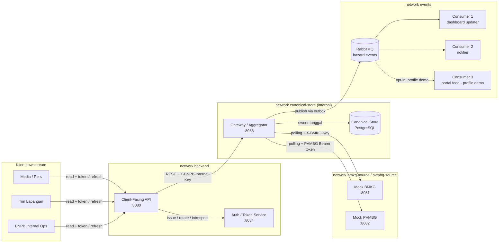

# Asosiasi Admirer Tsundere - IF4031 Milestone 1

Repositori ini berisi proof-of-concept platform koordinasi kebencanaan yang
menghubungkan dua instansi sumber, BMKG dan PVMBG, dengan layanan-layanan BNPB.
Dokumen ini adalah peta proyek, panduan menjalankan kode dengan Docker, dan
catatan kerja Anggota 2 (Mock BMKG, Auth, dan Client-Facing API).

Sumber kebutuhan utama:

- [Spesifikasi Tugas Besar M1](IF4031%20-%20Tugas%20Besar%20-%20M1.pdf)
- [Pembagian tugas M1](PEMBAGIAN-TUGAS-M1.md)
- [Kontrak BNPB v1](bnpb/contracts/v1/README.md)
- [Dokumentasi BMKG](bmkg/README.md)
- [Dokumentasi PVMBG](pvmbg/README.md)

## 1. Gambaran Sistem

Alur utama sistem adalah:



Tiga network Docker (`backend`, `canonical-store`, `events`) di atas bukan
sekadar pengelompokan logis: `canonical-store` ditandai `internal: true` pada
Compose, sehingga hanya Aggregator dan PostgreSQL yang benar-benar bisa
menjangkaunya. API dan Auth tidak mempunyai jalur jaringan ke PostgreSQL atau
RabbitMQ sama sekali.

Prinsip penting dari spesifikasi:

- Semua komunikasi lintas service dilakukan melalui jaringan.
- Canonical Store hanya boleh diakses langsung oleh Aggregator.
- Client-Facing API membaca data melalui API internal Aggregator.
- Kredensial BMKG, PVMBG, komunikasi internal BNPB, dan klien downstream
  berada pada domain kepercayaan yang berbeda.
- Setiap service mempunyai container, health check, log terstruktur, dan
  correlation ID.

## 2. Struktur dan Status Implementasi

| Komponen | Teknologi | Port | Status saat ini |
| --- | --- | ---: | --- |
| Mock BMKG | Rust, Axum | 8081 | Fitur utama sudah diimplementasikan: seed dan generator data, dua endpoint data, API key, delay 50-150 ms, health check, correlation ID, log, dan test. |
| Mock PVMBG | Kotlin, Ktor | 8082 | Fitur utama sudah diimplementasikan: login JWT, data vulkanik, delay dinamis, outage, perubahan schema, health check, log, dan test. |
| BNPB Aggregator | Go | 8083 internal | Polling kedua mock, mapping canonical, PostgreSQL owner, snapshot API, freshness, transactional outbox, AMQP publisher, readiness, dan test sudah diimplementasikan. |
| BNPB Client-Facing API | Go | 8080 | Login/refresh facade, introspection, filter, proyeksi summary/full, pemanggilan Aggregator, pemetaan error, readiness, dan test sudah diimplementasikan. |
| BNPB Auth | Go | 8084 internal | Tiga identitas, opaque token, access TTL 60 detik, sesi refresh absolut 8 jam, rotation/revocation, introspection, internal key, dan test sudah diimplementasikan. |
| Consumer 1 dan 2 | Go | 8085, 8086 | Subscriber RabbitMQ independen dengan efek SQLite lokal, deduplikasi persisten, log CID dan latensi AMQP. |
| Consumer 3 | Go | 8087 | Subscriber feed dan hanya aktif pada Compose profile `demo`. |
| PostgreSQL | Image resmi | internal | Canonical Store milik tunggal Aggregator, lengkap dengan migration dan outbox. |
| RabbitMQ | Image resmi | internal | Sudah didefinisikan di Compose BNPB untuk fan-out event. |

Fondasi Go yang sudah dapat dipakai semua service BNPB berada di
`bnpb/internal/platform`: konfigurasi tervalidasi, server timeout, graceful
shutdown, health check, pembatasan request bersamaan dengan respons 429,
recovery panic, structured logging, correlation ID, dan HTTP client.

Kontrak yang sudah tersedia:

- `HazardEvent` lengkap mempunyai 11 field wajib.
- `HazardSummary` merupakan allowlist tujuh field Ringkasan untuk Media.
- API internal Aggregator dirancang pada `GET /internal/hazards` dan
  `GET /internal/hazards/{hazard_id}`.
- Pesan broker memakai envelope `HazardNotification` dan target exchange
  fan-out `hazard.events` dengan semantik at-least-once.

### Orkestrasi saat ini

`compose.yaml` di root menggabungkan Compose BMKG, PVMBG, dan BNPB, kemudian
menempatkan Aggregator pada network sumber yang sesuai. Karena itu seluruh alur
mock -> Aggregator -> API -> client dapat dinyalakan dari root dengan satu
perintah. Compose per folder tetap berguna untuk pengembangan komponen secara
mandiri.

Broker-init memprovisikan identitas dan permission broker sebelum Aggregator
serta consumer dimulai.

## 3. Prasyarat Docker

Gunakan Docker Desktop dengan Linux containers dan Docker Compose 2.20 atau
lebih baru.

```powershell
docker --version
docker compose version
docker info
```

Pastikan `docker info` berhasil sebelum menjalankan perintah di bawah. Jika
gagal terhubung ke server, buka Docker Desktop dan tunggu hingga daemon siap.
Image `bnpb-api` dan `bnpb-auth` telah berhasil dibangun dengan konfigurasi ini.

Semua contoh berikut ditulis untuk PowerShell dan dijalankan dari root
repositori:

```powershell
Set-Location D:\Code\AAT\AsosiasiAdmirerTsundere
```

### 3.1 Menjalankan dari Linux/macOS (bash)

Bagian 4-7 di bawah ditulis untuk PowerShell. Blok ini adalah jalur setara
dalam bash yang cukup untuk menyiapkan konfigurasi dan menjalankan seluruh
sistem dari Linux/macOS; untuk skenario lanjutan (login PVMBG, admin toggle,
dsb.) pola yang sama (`curl` + `jq` menggantikan `Invoke-RestMethod`) tinggal
diterapkan ke perintah PowerShell terkait.

```bash
docker --version
docker compose version
docker info
cd /path/ke/repo   # root repositori
```

Siapkan ketiga `.env`:

```bash
# BMKG
cp bmkg/.env.example bmkg/.env
secret=$(openssl rand -hex 32)
sed -i.bak "s/^BMKG_API_KEY=.*/BMKG_API_KEY=$secret/" bmkg/.env && rm bmkg/.env.bak
unset secret

# PVMBG — isi manual PVMBG_JWT_SECRET, PVMBG_READER_CLIENT_ID/SECRET,
# PVMBG_ADMIN_CLIENT_ID/SECRET di pvmbg/.env memakai nilai dari perintah berikut
cp pvmbg/.env.example pvmbg/.env
openssl rand -hex 32

# BNPB — isi manual nilai kosong (lihat bagian 4.3): POSTGRES_PASSWORD,
# RABBITMQ_DEFAULT_PASS, BNPB_AUTH_INTERNAL_KEY, BNPB_AGGREGATOR_INTERNAL_KEY,
# BNPB_MEDIA/FIELD/OPS_CLIENT_SECRET, dst.
cp bnpb/.env.example bnpb/.env
openssl rand -hex 32
```

Jalankan seluruh sistem dari root:

```bash
docker compose up -d --build
docker compose ps
curl http://localhost:8080/health
curl http://localhost:8080/ready
docker compose logs -f api auth aggregator bmkg pvmbg
docker compose down
```

Smoke test BMKG:

```bash
cd bmkg
docker compose up -d --build
bmkgKey=$(grep '^BMKG_API_KEY=' .env | cut -d= -f2)
curl http://localhost:8081/health
curl -H "X-BMKG-Key: $bmkgKey" http://localhost:8081/seismic-events
curl -H "X-BMKG-Key: $bmkgKey" http://localhost:8081/tsunami-warnings
docker compose down
cd ..
```

Smoke test PVMBG (login reader lalu baca data; perlu `jq`, instal lewat
`apt`/`brew` bila belum ada):

```bash
cd pvmbg
docker compose up -d --build
curl http://localhost:8082/health

set -a; source .env; set +a
login=$(curl -s -X POST http://localhost:8082/auth/login \
  -H 'Content-Type: application/json' \
  -d "{\"client_id\":\"$PVMBG_READER_CLIENT_ID\",\"client_secret\":\"$PVMBG_READER_CLIENT_SECRET\"}")
token=$(echo "$login" | jq -r .access_token)
curl -H "Authorization: Bearer $token" http://localhost:8082/volcanic-reports
docker compose down
cd ..
```

Cek port yang bentrok:

```bash
ss -ltnp | grep -E ':(8080|8081|8082|8083|8084)\b'
# atau di macOS:
lsof -i -P -n | grep LISTEN | grep -E ':(8080|8081|8082|8083|8084)'
```

Testing tanpa Docker (bagian 7) sudah portable, kecuali wrapper Gradle:

```bash
cd pvmbg
chmod +x gradlew   # sekali saja, bila belum executable
./gradlew test     # ganti gradlew.bat
cd ..
```

## 4. Menyiapkan Konfigurasi

Jangan commit berkas `.env`. Ketiga contoh konfigurasi sudah tersedia dan
`.gitignore` harus tetap mengecualikan nilai rahasia.

### 4.1 BMKG

```powershell
Copy-Item bmkg/.env.example bmkg/.env
$secret = [Convert]::ToHexString(
  [Security.Cryptography.RandomNumberGenerator]::GetBytes(32)
).ToLowerInvariant()
(Get-Content bmkg/.env) -replace '^BMKG_API_KEY=.*$', "BMKG_API_KEY=$secret" |
  Set-Content bmkg/.env
Remove-Variable secret
```

`BMKG_API_KEY` wajib berbeda dari seluruh kredensial lain.

### 4.2 PVMBG

```powershell
Copy-Item pvmbg/.env.example pvmbg/.env
```

Edit `pvmbg/.env`, lalu ganti semua nilai contoh berikut dengan nilai unik:

- `PVMBG_JWT_SECRET`
- `PVMBG_READER_CLIENT_ID` dan `PVMBG_READER_CLIENT_SECRET`
- `PVMBG_ADMIN_CLIENT_ID` dan `PVMBG_ADMIN_CLIENT_SECRET`

Rahasia dapat dibuat dengan perintah PowerShell berikut:

```powershell
[Convert]::ToHexString(
  [Security.Cryptography.RandomNumberGenerator]::GetBytes(32)
).ToLowerInvariant()
```

### 4.3 BNPB

```powershell
Copy-Item bnpb/.env.example bnpb/.env
```

Untuk menyalakan stack BNPB, minimal isi nilai kosong berikut:

```dotenv
POSTGRES_PASSWORD=<rahasia-postgres>
RABBITMQ_DEFAULT_PASS=<rahasia-rabbitmq>
BNPB_AUTH_INTERNAL_KEY=<rahasia-khusus-API-ke-Auth-minimal-32-karakter>
BNPB_AGGREGATOR_INTERNAL_KEY=<rahasia-khusus-API-ke-Aggregator-minimal-32-karakter>
BNPB_MEDIA_CLIENT_SECRET=<rahasia-media-minimal-16-karakter>
BNPB_FIELD_CLIENT_SECRET=<rahasia-field-minimal-16-karakter>
BNPB_OPS_CLIENT_SECRET=<rahasia-ops-minimal-16-karakter>
BNPB_RABBITMQ_PUBLISHER_PASSWORD=<rahasia-publisher>
BNPB_CONSUMER_1_RABBITMQ_PASSWORD=<rahasia-dashboard>
BNPB_CONSUMER_2_RABBITMQ_PASSWORD=<rahasia-notifier>
BNPB_CONSUMER_3_RABBITMQ_PASSWORD=<rahasia-demo>
```

Untuk integrasi Aggregator dengan kedua mock, lengkapi juga:

```dotenv
BNPB_BMKG_API_KEY=<sama-dengan-BMKG_API_KEY>
BNPB_PVMBG_READER_CLIENT_ID=<sama-dengan-reader-PVMBG>
BNPB_PVMBG_READER_CLIENT_SECRET=<sama-dengan-secret-reader-PVMBG>
BNPB_AGGREGATOR_INTERNAL_KEY=<rahasia-khusus-API-ke-Aggregator>
BNPB_CANONICAL_DATABASE_URL=postgres://bnpb:<password>@postgres:5432/bnpb?sslmode=disable
BNPB_AMQP_URL=amqp://publisher:<rahasia-publisher>@rabbitmq:5672/
```

Nilai `BNPB_BMKG_API_KEY` memang harus sama dengan kunci yang BMKG validasi,
tetapi tidak boleh dipakai sebagai kredensial PVMBG, token klien, atau internal
key BNPB.

Seluruh variabel Auth dan Client-Facing API beserta nilai default non-rahasianya
tersedia di `bnpb/.env.example`. Lihat [README BNPB](bnpb/README.md) untuk daftar
lengkap dan contoh request.

## 5. Menjalankan Sistem

### 5.1 Seluruh sistem - direkomendasikan

Setelah ketiga file `.env` disiapkan, jalankan dari root repositori:

```powershell
docker compose up -d --build
docker compose ps
Invoke-RestMethod http://localhost:8080/health
Invoke-RestMethod http://localhost:8080/ready
```

Periksa juga `docker compose ps --all`: `broker-init` harus **Exited (0)** dan
lognya memuat `broker_provisioning_complete`. Detached `up` yang exit 0 belum
menjadi bukti alur data; cocokkan `message_id` pada `broker_publication` Aggregator
dan `message_received` consumer 1 serta 2. Job menunggu autentikasi/readiness
Management RabbitMQ dengan batas waktu; paket curl/jq sudah dibangun ke image.

`/health` memeriksa liveness API. `/ready` baru menghasilkan 200 ketika Auth dan
Aggregator siap; readiness Aggregator sendiri mensyaratkan Canonical Store siap.
Ikuti log alur utama dengan:

```powershell
docker compose logs -f api auth aggregator bmkg pvmbg
```

Hentikan seluruh sistem tanpa menghapus volume:

```powershell
docker compose down
```

### 5.2 Mock BMKG

```powershell
Set-Location bmkg
docker compose up -d --build
docker compose ps
docker compose logs -f bmkg
```

Pada terminal lain:

```powershell
$bmkgKey = (Get-Content .env | Where-Object { $_ -match '^BMKG_API_KEY=' }) -replace '^BMKG_API_KEY=', ''
Invoke-RestMethod http://localhost:8081/health
Invoke-RestMethod http://localhost:8081/seismic-events -Headers @{ 'X-BMKG-Key' = $bmkgKey }
Invoke-RestMethod http://localhost:8081/tsunami-warnings -Headers @{ 'X-BMKG-Key' = $bmkgKey }
```

Ekspektasi:

- `/health` menghasilkan HTTP 200;
- endpoint data tanpa atau dengan API key salah menghasilkan HTTP 401;
- endpoint data dengan API key benar menghasilkan JSON array;
- request mempunyai delay sekitar 50-150 ms;
- event baru muncul minimal setiap 10 detik pada konfigurasi default.

Hentikan service tanpa menghapus image:

```powershell
docker compose down
Set-Location ..
```

### 5.3 Mock PVMBG

```powershell
Set-Location pvmbg
docker compose up -d --build
docker compose ps
docker compose logs -f pvmbg
```

Health check:

```powershell
Invoke-RestMethod http://localhost:8082/health
```

Login reader dari nilai yang ada di `.env`:

```powershell
$pvmbgEnv = @{}
Get-Content .env | Where-Object { $_ -match '^[^#][^=]*=' } | ForEach-Object {
  $name, $value = $_ -split '=', 2
  $pvmbgEnv[$name] = $value
}
$loginBody = @{
  client_id = $pvmbgEnv.PVMBG_READER_CLIENT_ID
  client_secret = $pvmbgEnv.PVMBG_READER_CLIENT_SECRET
} | ConvertTo-Json
$login = Invoke-RestMethod http://localhost:8082/auth/login `
  -Method Post -ContentType 'application/json' -Body $loginBody
$readerHeaders = @{ Authorization = "Bearer $($login.access_token)" }
Invoke-RestMethod http://localhost:8082/volcanic-reports -Headers $readerHeaders
```

Skenario schema evolution, outage, delay 3 detik, dan expiry dijelaskan lengkap
pada [README PVMBG](pvmbg/README.md#trigger-every-scenario).

```powershell
docker compose down
Set-Location ..
```

### 5.4 Stack BNPB

```powershell
Set-Location bnpb
docker compose up -d --build
docker compose ps
docker compose logs -f
```

Hanya `api` dipublikasikan ke host pada port 8080. Auth dan Aggregator tetap
internal. Periksa liveness dan readiness API dari host:

```powershell
Invoke-RestMethod http://localhost:8080/health
Invoke-RestMethod http://localhost:8080/ready
```

Respons yang diharapkan:

```json
{"service":"bnpb-api","status":"ok"}
```

Periksa health container internal lainnya melalui:

```powershell
docker compose ps
```

Alur login, refresh, akses berbasis role, dan kontrak endpoint dijelaskan pada
[README BNPB](bnpb/README.md).

Menyalakan Consumer 3 untuk demo:

```powershell
docker compose --profile demo up -d --build
```

Hentikan stack:

```powershell
docker compose down
Set-Location ..
```

Volume PostgreSQL dan RabbitMQ sengaja dipertahankan oleh `down`. Gunakan
`docker compose down -v` hanya jika benar-benar ingin menghapus data lokal
kedua volume tersebut.

## 6. Perintah Operasional Penting

Jalankan perintah pada folder yang memiliki `compose.yaml` terkait.

```powershell
# Melihat status
docker compose ps

# Mengikuti log satu service
docker compose logs -f <nama-service>

# Rebuild dan restart hanya satu service
docker compose up -d --build <nama-service>

# Menghentikan tanpa menghapus container
docker compose stop <nama-service>

# Menyalakan lagi tanpa build
docker compose up -d --no-build <nama-service>

# Memuat ulang nilai .env
docker compose up -d --force-recreate <nama-service>
```

Jika port 8080, 8081, atau 8082 sudah dipakai, cari proses/container pemiliknya:

```powershell
Get-NetTCPConnection -State Listen | Where-Object LocalPort -in 8080,8081,8082,8083,8084
docker ps --format 'table {{.Names}}\t{{.Ports}}'
```

## 7. Pengujian yang Tersedia

Tanpa Docker, kebutuhan lokalnya adalah Rust stable terbaru untuk BMKG, JDK 21
untuk PVMBG, dan Go sesuai `bnpb/go.mod` untuk BNPB.

```powershell
# BMKG
Set-Location bmkg
cargo test

# PVMBG
Set-Location ../pvmbg
./gradlew.bat test

# BNPB
Set-Location ../bnpb
go test ./...
go vet ./...
go build ./cmd/...
```

Catatan lingkungan saat dokumen dibuat:

- Rust belum tersedia di host, tetapi build BMKG dapat dilakukan di Docker.
- Java 23 tersedia; proyek PVMBG memakai toolchain/target JDK 21.
- Go host adalah 1.23.3, sedangkan `go.mod` meminta Go 1.25 dengan toolchain
  1.26.8. Gunakan toolchain yang sesuai atau build melalui Docker.

## 8. Fokus Kita sebagai Anggota 2

Menurut `PEMBAGIAN-TUGAS-M1.md` dan halaman 6-15 serta 20-21 spesifikasi,
Anggota 2 bertanggung jawab atas tiga area berikut.

### 8.1 Mock BMKG - sebagian besar sudah selesai

Checklist verifikasi, bukan implementasi ulang:

- `GET /seismic-events?since=...`, `GET /tsunami-warnings?since=...`, dan
  `GET /health` tersedia.
- Seed historis minimal 20 record dan event baru minimal satu per 10 detik.
- Delay 50-150 ms dan autentikasi `X-BMKG-Key`.
- Kredensial PVMBG ditolak ketika dipakai ke BMKG.
- Warning hanya terkait event yang berpotensi tsunami.
- Docker, health check, log terstruktur, dan correlation ID dapat dibuktikan.

Yang masih perlu dilakukan adalah menjalankan test, menyiapkan bukti demo, dan
memastikan integrasi Aggregator memakai semantik `since` yang benar. Endpoint
warning BMKG memfilter menggunakan field tambahan `issued_at`, bukan
`estimated_arrival`.

### 8.2 Auth / Token Service - sudah diimplementasikan

Desain mengikuti sketch yang disepakati: client tidak mengakses Auth langsung.
Client memanggil facade publik pada API, kemudian API memanggil route internal
Auth dengan `X-BNPB-Auth-Key`:

- `POST /internal/auth/login` menerbitkan access dan refresh token;
- `POST /internal/auth/refresh` merotasi keduanya dan langsung mencabut access
  token lama;
- `POST /internal/auth/introspect` memvalidasi access token pada setiap request
  data dan mengembalikan identitas serta role;
- Auth memetakan tiga client server-side ke role `media`, `field`, dan `ops`;
- token berupa nilai acak opaque 256-bit. Hanya hash SHA-256 token dan expiry
  yang disimpan dalam private memory Auth;
- access TTL default 60 detik, sedangkan sesi refresh mempunyai batas absolut
  8 jam. Refresh tidak memperpanjang batas absolut tersebut;
- refresh token satu kali pakai dan aman terhadap dua refresh bersamaan: hanya
  satu request yang berhasil;
- kredensial salah menghasilkan 401, sedangkan internal key salah menghasilkan
  403.

Konsekuensi POC: seluruh sesi hilang ketika Auth restart dan state in-memory
tidak mendukung beberapa replika tanpa shared session store.

Konfigurasi utamanya:

```dotenv
BNPB_AUTH_ACCESS_TOKEN_TTL=60s
BNPB_AUTH_REFRESH_SESSION_TTL=8h
BNPB_AUTH_INTERNAL_KEY=<minimal-32-karakter>
BNPB_MEDIA_CLIENT_ID=media
BNPB_MEDIA_CLIENT_SECRET=<secret>
BNPB_FIELD_CLIENT_ID=field-team
BNPB_FIELD_CLIENT_SECRET=<secret>
BNPB_OPS_CLIENT_ID=internal-ops
BNPB_OPS_CLIENT_SECRET=<secret>
```

### 8.3 Client-Facing API - sudah diimplementasikan

API mempublikasikan empat route pada port 8080:

- `POST /auth/login` dan `POST /auth/refresh` sebagai facade menuju Auth;
- `GET /v1/hazards` untuk list, filter, pagination, dan freshness metadata;
- `GET /v1/hazards/{hazard_id}` untuk detail satu hazard.

Endpoint data memerlukan `Authorization: Bearer <access_token>`. Parameter
`view` menerima `summary` atau `full` dan default-nya `summary`. Media selalu
dibatasi ke struct allowlist tujuh field; permintaan Media dengan `view=full`
menghasilkan 403. Field dan Ops boleh menerima sebelas field penuh.

API melakukan introspection pada setiap request, lalu memanggil Aggregator
melalui jaringan memakai `X-BNPB-Internal-Key`. API tidak mempunyai koneksi ke
PostgreSQL. `X-Correlation-ID` diteruskan, latensi outbound dicatat, metadata
freshness dipertahankan, dan error internal disanitasi menjadi respons publik.
Kegagalan Auth atau respons internal yang tidak sah dipetakan ke 503. Readiness
API memeriksa Auth dan Aggregator secara paralel.

## 9. Status Kerja Orang 2

Yang sudah selesai:

1. Kontrak Auth dan Client-Facing API dibekukan sesuai sketch.
2. Konfigurasi, validator, dan Compose service Auth/API sudah diperbarui.
3. Auth dan test login, expiry, refresh rotation, revocation, batas sesi 8 jam,
   concurrency, serta pemisahan tiga role sudah tersedia.
4. HTTP client API -> Auth/Aggregator membawa internal key, correlation ID,
   timeout, dan pencatatan latensi.
5. Route publik, filter, pemetaan error, dan proyeksi allowlist sudah tersedia.
6. Test akses Media versus Field/Ops, full-view 403, token invalid, query invalid,
   dan kondisi Aggregator/Auth bermasalah sudah tersedia.

Pekerjaan integrasi yang masih bergantung pada komponen lain:

1. Jalankan demo lintas-container untuk tiga identitas, expiry alami, refresh,
   dan bukti access token lama ditolak.
2. Jalankan skenario P3/P2 dan kumpulkan log correlation ID serta hasil load test
   untuk laporan.

## 10. Definition of Done Anggota 2

- Mock BMKG lolos test dan skenario autentikasi silang.
- Tiga client benar-benar memakai kredensial berbeda.
- TTL access token default 60 detik dan dapat dikonfigurasi.
- Refresh tidak meminta client secret kembali dan merotasi token.
- Access token lama ditolak setelah refresh.
- Media tidak pernah menerima empat field Mentah.
- Permintaan Media untuk proyeksi full/raw menghasilkan 403.
- Field/Ops menerima payload lengkap melalui API, bukan database langsung.
- API tetap sehat di bawah load test 50 koneksi selama minimal 60 detik;
  throughput, p50/p95/p99, error, dan 429 tercatat.
- Outage PVMBG tidak mengubah permintaan BMKG-only menjadi lambat atau 500.
- Semua service mempunyai health check, structured log, correlation ID, timeout,
  Dockerfile, dan environment example.
- Root Compose dapat menjalankan seluruh sistem dalam satu perintah.
- README, bukti demo, dan bagian laporan P3/P2 sesuai kode yang benar-benar
  dijalankan.

## 11. Troubleshooting Singkat

### Docker daemon tidak aktif

Gejala: `failed to connect to the docker API ... dockerDesktopLinuxEngine`.

Solusi: buka Docker Desktop, pilih Linux containers, tunggu engine siap, lalu
jalankan ulang `docker info`.

### Compose menolak `.env`

Pastikan menjalankan perintah dari folder komponen dan berkas berikut ada:

```powershell
Test-Path bmkg/.env
Test-Path pvmbg/.env
Test-Path bnpb/.env
```

### Container unhealthy

```powershell
docker compose ps
docker compose logs --tail 200 <nama-service>
docker inspect <nama-container> --format '{{json .State.Health}}'
```

### Perubahan `.env` tidak terbaca

```powershell
docker compose up -d --force-recreate <nama-service>
```

### Aggregator tidak menemukan `bmkg` atau `pvmbg`

Jalankan `docker compose up` dari root repositori. Compose root memasang
Aggregator ke network `bmkg-source` dan `pvmbg-source`; Compose per folder tidak
dimaksudkan untuk menjalankan integrasi lintas-stack sendirian. Jika DNS sudah
benar tetapi request mendapat 401/403, pastikan kredensial Aggregator sama dengan
kredensial yang divalidasi masing-masing mock.
