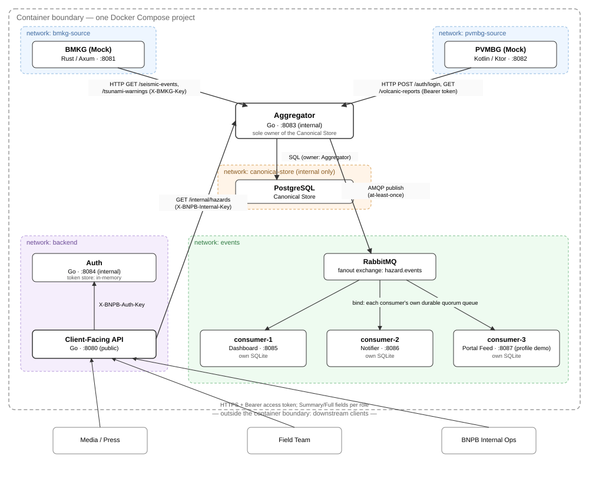

# TsundereDISTRIBUTED - Asosiasi Admirer Tsundere

TsundereDISTRIBUTED is a disaster-coordination platform that aggregates seismic and volcanic hazard reports from two independent agency sources, Indonesia's BMKG (meteorology/seismology) and PVMBG (volcanology), into one canonical event stream. Incoming reports are mapped into a single `HazardEvent` format, stored in a database owned by exactly one service, published to a message broker, and served to downstream clients through a role-based read API — with independent consumers reacting to the same event stream for dashboards, alerting, and third-party feeds.

This repository is the Milestone 1 submission for IF4031 Arsitektur Aplikasi Terdistribusi. It contains mock implementations of both agency sources, the full BNPB backend (ingestion, canonical storage, authentication, client-facing API, and message-broker consumers), and the Docker Compose orchestration tying all of it into one runnable system.

## Table of Contents

- [Technology and Frameworks](#technology-and-frameworks)
- [Program Structure](#program-structure)
- [Program Requirements](#program-requirements)
- [Running the Application](#running-the-application)
- [Endpoints](#endpoints)
- [Creators](#creators)

## Technology and Frameworks

| Component | Language / Framework | Version |
| --- | --- | --- |
| Mock BMKG | Rust, Axum | Rust edition 2024 · Axum 0.8.9 · Tokio 1.53.1 |
| Mock PVMBG | Kotlin, Ktor | Kotlin 2.4.0 · Ktor 3.5.2 · JVM toolchain 21 |
| BNPB backend (Aggregator, Auth, Client-Facing API, consumer-1/2/3) | Go | Go 1.26.0 · toolchain 1.26.8 |
| Canonical Store | PostgreSQL | 18.6 |
| Message broker | RabbitMQ | 4.3.5 (management image) |
| Per-consumer local storage | SQLite via `modernc.org/sqlite` | pure Go, no CGO |
| Orchestration | Docker, Docker Compose | Compose file `include:` (requires Compose 2.20+) |
| Acceptance testing | Python | 3.9+ (standard library only) |

## Program Structure



Every box above is an independent Docker container with its own Dockerfile and lifecycle. Dashed, colored regions are separate Docker networks — a service can only reach what it shares a network with. This is what keeps BMKG and PVMBG polling fully isolated from each other (a slow PVMBG can never block BMKG traffic), and what makes the Canonical Store reachable only by the Aggregator.

Simplified file layout:

```text
.
├── bmkg/                   # Mock BMKG (Rust/Axum)
│   └── src/                # config, models, plugins, routing, seed, state
├── pvmbg/                  # Mock PVMBG (Kotlin/Ktor)
│   └── src/                # main, test
├── bnpb/                   # BNPB backend (Go)
│   ├── cmd/                # aggregator, api, auth, consumer-1/2/3
│   ├── internal/           # per-service packages + shared platform/
│   ├── broker/             # RabbitMQ provisioning
│   └── contracts/v1/       # OpenAPI contract + schemas
├── testing/                # acceptance suites (Python), per Problem
│   ├── P01/ P02/ P03/ P04/ P05/
│   └── common/             # shared test helpers
├── docs/architecture.svg   # diagram used above
├── compose.yaml            # root orchestration (includes all three)
├── compose.override.yaml   # host-exposed inspection ports
└── README.md
```

Each of `bmkg/`, `pvmbg/`, and `bnpb/` also has its own `README.md` with component-specific detail, and its own `compose.yaml` so it can be developed and run standalone.

## Program Requirements

- Docker Engine and Docker Compose **2.20 or newer** (required for the root `compose.yaml`'s `include:` directive).
- Enough free memory/CPU for eleven containers at once (two mocks, five BNPB Go services, PostgreSQL, RabbitMQ, plus the one-shot `broker-init`).
- These host ports free: `8080` (Client-Facing API), `8081` (BMKG), `8082` (PVMBG), `8083` (Aggregator, inspection only), `15672` (RabbitMQ management UI, inspection only).
- `openssl` (or any equivalent) to generate secrets when preparing `.env` files.

Optional, only needed if you want to run a component's code or tests without Docker:

- Rust (stable) for BMKG.
- JDK 21 for PVMBG.
- Go matching `bnpb/go.mod` (1.26.x) for the BNPB backend.
- Python 3.9+ for the acceptance suites under `testing/`.

## Running the Application

### 1. Prepare configuration

Each of `bmkg/`, `pvmbg/`, and `bnpb/` needs its own `.env`, copied from its `.env.example` and filled with real secrets (never commit these). See each component's own README for the exact variables; `openssl rand -hex 32` is used throughout to generate secret values.

```bash
cp bmkg/.env.example bmkg/.env
cp pvmbg/.env.example pvmbg/.env
cp bnpb/.env.example bnpb/.env
```

### 2. Start from a clean state

Run these from the **repository root**.

**Core system only** (consumer-3 excluded — this is the default and what you want for normal operation):

```bash
docker compose up -d --build
docker compose ps
curl http://localhost:8080/health
curl http://localhost:8080/ready
```

**Core system with the third consumer included from the start** (consumer-3 exists purely to demonstrate that a consumer can be plugged into the broker without touching the producer — see below for adding it live instead):

```bash
docker compose --profile demo up -d --build
```

Either way, check `docker compose ps --all`: the one-shot `broker-init` service must show **Exited (0)** before the Aggregator or any consumer can connect to RabbitMQ.

### 3. Add a service to an already-running system, live

This is the normal way to bring up consumer-3: start the core system first (step 2, without `--profile demo`), then add it later without restarting anything already running.

```bash
docker compose --profile demo up -d --build consumer-3
```

`consumer-1` and `consumer-2` are untouched by this — you can confirm with `docker inspect <container> --format '{{.State.StartedAt}}'` before and after, the timestamps won't change.

### 4. Stop a single service, live, without shutting down the rest

```bash
docker compose stop consumer-3
```

Everything else — the Aggregator, the other two consumers, the API — keeps running normally. RabbitMQ keeps queueing messages for `consumer-3`'s own queue while it's down; restart it the same way to pick the backlog back up:

```bash
docker compose start consumer-3
```

This works for any single service, not just consumer-3 — swap the name (e.g. `docker compose stop pvmbg`) to take any one component down independently.

To rebuild a service after changing its code, without touching anything else:

```bash
docker compose up -d --build <service-name>
```

### 5. Shut down the entire system

Preserve all data (PostgreSQL, RabbitMQ, each consumer's SQLite) for next time:

```bash
docker compose down
```

Wipe all data and start fresh next time:

```bash
docker compose down -v
```

### Other useful commands

```bash
docker compose ps                        # status of every service
docker compose logs -f <service-name>     # follow one service's logs
docker compose logs -f api auth aggregator bmkg pvmbg   # follow the main data-flow path
```

## Endpoints

The internal contract between the Aggregator and the Client-Facing API is formally specified as an OpenAPI 3.1 document with JSON Schemas, under `bnpb/contracts/v1/`. Run it locally with Swagger UI:

```bash
docker run --rm -p 8089:8080 \
  -e SWAGGER_JSON=/contract/openapi.yaml \
  -v "$(pwd)/bnpb/contracts/v1:/contract" \
  swaggerapi/swagger-ui
```

Then open `http://localhost:8089` in a browser.

This contract covers the **internal** read API (`GET /internal/hazards`, `GET /internal/hazards/{hazard_id}`) that only the Client-Facing API is allowed to call. The **public** endpoints that downstream clients (Media, Field Team, BNPB Internal Ops) actually use — `POST /auth/login`, `POST /auth/refresh`, `GET /v1/hazards`, `GET /v1/hazards/{hazard_id}` — are documented in prose, with full request/response examples and the Summary/Full field-projection rules, in [`bnpb/README.md`](bnpb/README.md). Each mock source's own endpoints are documented the same way in [`bmkg/README.md`](bmkg/README.md) and [`pvmbg/README.md`](pvmbg/README.md).

There is no graphical interface anywhere in this system — every component, including the three broker consumers, is a headless API driven by `curl`, a script, or the Swagger UI above.

## Creators

<table>
    <tr align="left">
        <td><b>NIM</b></td>
        <td><b>Name</b></td>
        <td align="center"><b>GitHub</b></td>
    </tr>
    <tr align="left">
        <td>13523056</td>
        <td>Salman Hanif</td>
        <td align="center" >
            <div style="margin-right: 20px;">
            <a href="https://github.com/salmaanhaniif" >
                 
                <br/> <sub><b> @salmaanhaniif </b></sub>
            </a><br/>
            </div>
        </td>
    </tr>
    <tr align="left">
        <td>13523100</td>
        <td>Aryo Wisanggeni</td>
        <td align="center" >
            <div style="margin-right: 20px;">
            <a href="https://github.com/Staryo40" >
                 
                <br/> <sub><b> @Staryo40 </b></sub>
            </a><br/>
            </div>
        </td>
    </tr>
    <tr align="left">
        <td>13523106</td>
        <td>Athian Nugraha Muarajuang</td>
        <td align="center" >
            <div style="margin-right: 20px;">
            <a href="https://github.com/Starath" >
                 
                <br/> <sub><b> @Starath </b></sub>
            </a><br/>
            </div>
        </td>
    </tr>
</table>
