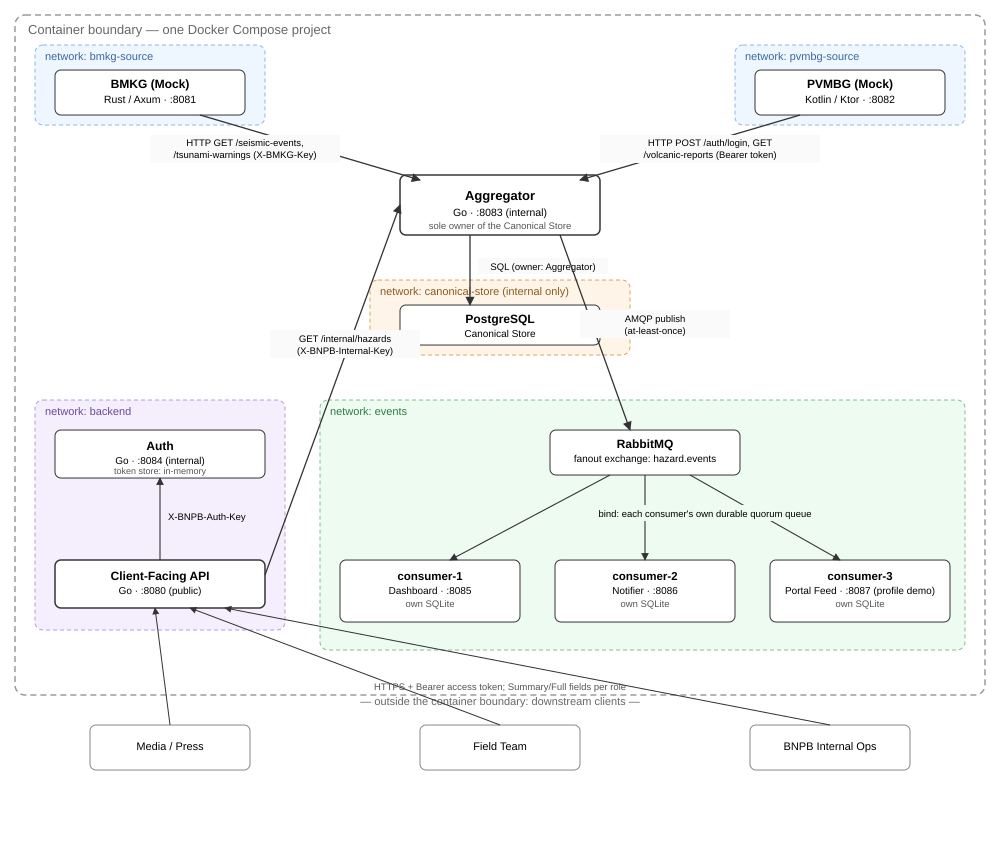

# TsundereDISTRIBUTED - Asosiasi Admirer Tsundere

TsundereDISTRIBUTED is a disaster-coordination platform that aggregates agency reports into canonical hazard records, stores them behind an Aggregator-owned storage boundary, publishes notifications, and serves role-specific client views. The BNPB source now also includes M2 work for durable routed ingestion, guarded ownership, bounded partial cross-shard reads, Audit, catalog loading and measurements.

This repository contains the Milestone 1 application and ongoing Milestone 2 implementation. The local Compose stack remains a development environment; no verified Kubernetes deployment command or external M2 acceptance is claimed.

Milestone 2 runs the same system on a two-node Kubernetes (k3s) cluster; see [Running on Kubernetes (Milestone 2)](#running-on-kubernetes-milestone-2). Docker Compose remains the way to develop and run the acceptance suites locally.

## Table of Contents

- [Technology and Frameworks](#technology-and-frameworks)
- [Program Structure](#program-structure)
- [Program Requirements](#program-requirements)
- [Configuration](#configuration)
- [Running the Application](#running-the-application)
- [Running on Kubernetes (Milestone 2)](#running-on-kubernetes-milestone-2)
- [Acceptance Testing (P01–P05)](#acceptance-testing-p01p05)
- [Milestone 2 Scenarios (P3 and P4)](#milestone-2-scenarios-p3-and-p4)
- [Endpoints](#endpoints)
- [Creators](#creators)

## Technology and Frameworks

| Component | Language / Framework | Version |
| --- | --- | --- |
| Mock BMKG | Rust, Axum | Rust edition 2024 · Axum 0.8.9 · Tokio 1.53.1 |
| Mock PVMBG | Kotlin, Ktor | Kotlin 2.4.0 · Ktor 3.5.2 · JVM toolchain 21 |
| BNPB backend | Go | go.mod targets Go 1.26.0 · observed local toolchain 1.26.8 |
| Canonical storage | PostgreSQL | Compose image 18.6 · observed installed local PostgreSQL 18.1 |
| Message broker | RabbitMQ | 4.3.5 (management image) |
| Per-consumer local storage | SQLite via `modernc.org/sqlite` | pure Go, no CGO |
| Orchestration | Docker, Docker Compose | Compose 2.24.4+ (`include:` and `!override`) |
| Acceptance testing | Python | 3.9+; P01/P04 also require `jsonschema` |

## Program Structure



Every box above is an independent Docker container with its own Dockerfile and lifecycle. Dashed, colored regions are separate Docker networks — a service can only reach what it shares a network with. This is what keeps BMKG and PVMBG polling fully isolated from each other (a slow PVMBG can never block BMKG traffic), and what makes the Canonical Store reachable only by the Aggregator.

Simplified file layout:

```text
.
├── bmkg/                   # Mock BMKG (Rust/Axum)
│   └── src/                # config, models, plugins, routing, seed, state
├── pvmbg/                  # Mock PVMBG (Kotlin/Ktor)
│   └── src/                # main, test
├── bnpb/                   # BNPB backend (Go)
│   ├── cmd/                # aggregator, api, auth, consumer-1/2/3, field-intake, satellite
│   ├── internal/           # per-service packages + shared platform/
│   ├── broker/             # RabbitMQ provisioning
│   └── contracts/v1/       # OpenAPI contract + schemas
├── k8s/                    # Kubernetes manifests (Kustomize) for Milestone 2
│   ├── config/             # ConfigMap sources (*.env)
│   └── secrets.env.example # Secret keys (fill secrets.env locally; not tracked)
├── testing/                # acceptance suites (Python), per Problem
│   ├── P01/ P02/ P03/ P04/ P05/
│   ├── M2-P3/ M2-P4/       # Milestone 2: failed messages, field reports, Feed Satelit
│   └── common/             # shared test helpers
├── docs/architecture.svg   # diagram used above
├── KUBERNETES-DEPLOYMENT.md # step-by-step k3s install and deploy
├── paradigma-design.md     # visual paradigm for the analytics dashboard (A2-06)
├── configure_env.py        # cross-platform local configuration setup
├── compose.yaml            # root orchestration (includes all three)
├── compose.override.yaml   # host-exposed inspection ports
└── README.md
```

Each of `bmkg/`, `pvmbg/`, and `bnpb/` also has its own `README.md` with component-specific detail, and its own `compose.yaml` so it can be developed and run standalone. Kubernetes deploy is documented in [`KUBERNETES-DEPLOYMENT.md`](KUBERNETES-DEPLOYMENT.md) and summarized under [Running on Kubernetes (Milestone 2)](#running-on-kubernetes-milestone-2).

## Program Requirements

- Docker with Docker Compose **2.24.4 or newer** (required for the Compose files' `include:` and `!override` features).
  - **Windows:** Docker Desktop with the WSL 2 backend and Linux containers enabled.
  - **macOS:** Docker Desktop.
  - **Linux:** Docker Engine with the Compose plugin, or Docker Desktop. Your user must be able to run Docker commands.
- Enough free memory/CPU for eleven containers at once (two mocks, five BNPB Go services, PostgreSQL, RabbitMQ, plus the one-shot `broker-init`).
- These host ports free: `8080` (Client-Facing API), `8081` (BMKG), `8082` (PVMBG), `8083` (Aggregator, inspection only), `15672` (RabbitMQ management UI, inspection only).
- Python 3.9+ if using the configuration script below or running acceptance tests. You can also prepare the `.env` files manually.

Optional, only needed if you want to run a component's code or tests without Docker:

- Rust (stable) for BMKG.
- JDK 21 for PVMBG.
- Go matching `bnpb/go.mod` (1.26.x) for the BNPB backend.

### Terminal conventions

Run commands from the repository root. Examples marked **PowerShell** target
Windows; examples marked **Bash/zsh** target Linux/macOS (or a Linux terminal
inside WSL). Commands in `text` blocks work in either shell. Windows Command
Prompt uses different environment-variable syntax; use PowerShell for the
Windows examples.

The README uses `python` for Python 3.9+. If that command is unavailable, use
`py -3` on Windows or `python3` on Linux/macOS in its place. After activating
the test virtual environment, `python` selects that environment on all three
operating systems.

Paths such as `/data/consumer-1.db` and executable names such as `/bin/sh` in
the Compose files are inside Linux containers; they do not require a Linux
host.

## Configuration

The root Compose project uses three ignored files: `bmkg/.env`, `pvmbg/.env`,
and `bnpb/.env`. For a fresh checkout, run the included
[`configure_env.py`](configure_env.py) script from the repository root:

```text
python configure_env.py
```

Use `py -3 configure_env.py` on Windows or `python3 configure_env.py` on
Linux/macOS if `python` is unavailable. No extra Python packages are needed.
The script creates all three files from the tracked examples and generates
random credentials with matching values across services. It refuses to
overwrite any existing `.env` file; edit existing configuration manually.

If you prefer manual configuration, copy the examples using your file manager
or these commands, then fill in the required values listed below:

**PowerShell:**

```powershell
Copy-Item bmkg/.env.example bmkg/.env
Copy-Item pvmbg/.env.example pvmbg/.env
Copy-Item bnpb/.env.example bnpb/.env
```

**Bash/zsh:**

```bash
cp bmkg/.env.example bmkg/.env
cp pvmbg/.env.example pvmbg/.env
cp bnpb/.env.example bnpb/.env
```

For manual setup, generate a separate secret for each independent credential
with this portable command; reuse a value only where the tables say `match`:

```text
python -c "import secrets; print(secrets.token_hex(32))"
```

The script writes generated secrets only to ignored `.env` files. Do not paste them
into logs, evidence, commits, or issue reports. If a password is changed after
the database or RabbitMQ volume has already been initialized, use a fresh
volume (`docker compose --profile demo down -v`) or restore the original value.

### Complete variable list

The tables below describe the active example settings; optional M2 feature settings are also listed in the BNPB README and remain commented out in `bnpb/.env.example` unless their dependencies and credentials are configured. `BNPB_AUDIT_CHECKSUM_TIMEOUT` is an optional checksum-only query deadline (default 5s, range 1ms–1m); it does not change the public read timeout default of 200ms.

#### `bmkg/.env`

| Variable | Default | Purpose / constraint |
| --- | --- | --- |
| `BMKG_API_KEY` | `required` | Secret sent as `X-BMKG-Key`; must match `BNPB_BMKG_API_KEY`. |
| `BMKG_PORT` | `8081` | HTTP listen port. |
| `BMKG_RESPONSE_DELAY_MIN_MS` | `50` | Minimum response delay; must be ≤ the maximum. |
| `BMKG_RESPONSE_DELAY_MAX_MS` | `150` | Maximum response delay; equal bounds make the delay fixed. |
| `BMKG_GENERATOR_INTERVAL_SECONDS` | `10` | New-event interval in seconds; minimum `0.001`. |
| `BMKG_LOG_LEVEL` | `INFO` | `TRACE`, `DEBUG`, `INFO`, `WARN`, `ERROR`, or `OFF`. |
| `BMKG_LOG_FORMAT` | `json` | `json` or `text`, lowercase. |

#### `pvmbg/.env`

| Variable | Default | Purpose / constraint |
| --- | --- | --- |
| `PVMBG_JWT_SECRET` | `required` | JWT signing/verification secret; use at least 32 random bytes. |
| `PVMBG_READER_CLIENT_ID` | `reader-client` | Read-only client ID; must match `BNPB_PVMBG_READER_CLIENT_ID`. |
| `PVMBG_READER_CLIENT_SECRET` | `required` | Read-only client secret; must match `BNPB_PVMBG_READER_CLIENT_SECRET`. |
| `PVMBG_ADMIN_CLIENT_ID` | `admin-client` | Operator/admin client ID. |
| `PVMBG_ADMIN_CLIENT_SECRET` | `required` | Operator/admin client secret; keep it different from the reader secret. |
| `PVMBG_TOKEN_TTL_SECONDS` | `300` | Access-token lifetime; use `30`–`60` for an expiry demo. |
| `PVMBG_LOGIN_RATE_LIMIT` | `5` | Login attempts per minute per client/IP. |
| `PVMBG_RESPONSE_DELAY_MIN_MS` | `500` | Minimum delay for non-admin responses; must be ≤ maximum. |
| `PVMBG_RESPONSE_DELAY_MAX_MS` | `3000` | Maximum delay; set both bounds to `3000` for the P02 load scenario. |
| `PVMBG_LOG_LEVEL` | `INFO` | `TRACE`, `DEBUG`, `INFO`, `WARN`, `ERROR`, or `OFF`. |
| `PVMBG_LOG_FORMAT` | `json` | `json` or `text`, lowercase. |
| `PVMBG_GENERATOR_INTERVAL_SECONDS` | `10` | New-report interval in seconds; minimum `0.001`. |

#### `bnpb/.env`: database, broker, platform, and addresses

| Variable | Default | Purpose / constraint |
| --- | --- | --- |
| `POSTGRES_DB` | `bnpb` | Canonical Store database name. |
| `POSTGRES_USER` | `bnpb` | Canonical Store database user. |
| `POSTGRES_PASSWORD` | `required` | PostgreSQL password for the privileged startup migration/authority DSN; restricted runtime writer credentials are separate. |
| `RABBITMQ_DEFAULT_USER` | `bnpb` | RabbitMQ bootstrap/admin user. |
| `RABBITMQ_DEFAULT_PASS` | `required` | RabbitMQ bootstrap/admin password. |
| `BNPB_LOG_LEVEL` | `INFO` | Shared BNPB log level. |
| `BNPB_MAX_IN_FLIGHT` | `64` | Shared HTTP admission limit. |
| `BNPB_OUTBOUND_HTTP_TIMEOUT` | `5s` | Shared outbound HTTP timeout. |
| `BNPB_READ_HEADER_TIMEOUT` | `5s` | HTTP server header-read timeout. |
| `BNPB_READ_TIMEOUT` | `10s` | HTTP server read timeout. |
| `BNPB_WRITE_TIMEOUT` | `10s` | HTTP server write timeout. |
| `BNPB_IDLE_TIMEOUT` | `60s` | HTTP keep-alive idle timeout. |
| `BNPB_SHUTDOWN_TIMEOUT` | `10s` | Graceful shutdown budget (`aggregator` uses this value). |
| `BNPB_API_HTTP_ADDR` | `:8080` | Client-Facing API listen address. |
| `BNPB_AGGREGATOR_HTTP_ADDR` | `:8083` | Aggregator listen address. |
| `BNPB_AUTH_HTTP_ADDR` | `:8084` | Auth service listen address. |
| `BNPB_CONSUMER_1_HTTP_ADDR` | `:8085` | Consumer-1 listen address. |
| `BNPB_CONSUMER_2_HTTP_ADDR` | `:8086` | Consumer-2 listen address. |
| `BNPB_CONSUMER_3_HTTP_ADDR` | `:8087` | Consumer-3 listen address. |

#### `bnpb/.env`: API and authentication

| Variable | Default | Purpose / constraint |
| --- | --- | --- |
| `BNPB_AUTH_ACCESS_TOKEN_TTL` | `60s` | BNPB access-token lifetime. |
| `BNPB_AUTH_REFRESH_SESSION_TTL` | `8h` | Absolute refresh-session lifetime; must be ≥ access TTL. |
| `BNPB_AUTH_INTERNAL_KEY` | `required` | API ↔ Auth trust key; at least 32 bytes. |
| `BNPB_MEDIA_CLIENT_ID` | `media` | Downstream Media identity. |
| `BNPB_MEDIA_CLIENT_SECRET` | `required` | Media secret; at least 32 bytes. |
| `BNPB_FIELD_CLIENT_ID` | `field-team` | Downstream Field Team identity. |
| `BNPB_FIELD_CLIENT_SECRET` | `required` | Field Team secret; at least 32 bytes. |
| `BNPB_OPS_CLIENT_ID` | `internal-ops` | Downstream BNPB Internal Ops identity. |
| `BNPB_OPS_CLIENT_SECRET` | `required` | Ops secret; at least 32 bytes. |
| `BNPB_AGGREGATOR_BASE_URL` | `http://aggregator:8083` | API route to the Aggregator. |
| `BNPB_AUTH_BASE_URL` | `http://auth:8084` | API route to Auth. |

#### `bnpb/.env`: Aggregator source, storage, and polling

| Variable | Default | Purpose / constraint |
| --- | --- | --- |
| `BNPB_BMKG_BASE_URL` | `http://bmkg:8081` | BMKG origin without path/query. |
| `BNPB_PVMBG_BASE_URL` | `http://pvmbg:8082` | PVMBG origin without path/query. |
| `BNPB_BMKG_API_KEY` | `required / match` | BMKG credential; equal to `BMKG_API_KEY`. |
| `BNPB_PVMBG_READER_CLIENT_ID` | `required / match` | PVMBG reader ID; equal to `PVMBG_READER_CLIENT_ID`. |
| `BNPB_PVMBG_READER_CLIENT_SECRET` | `required / match` | PVMBG reader secret; equal to `PVMBG_READER_CLIENT_SECRET`. |
| `BNPB_AGGREGATOR_INTERNAL_KEY` | `required` | API ↔ Aggregator trust key; at least 32 bytes. |
| `BNPB_CANONICAL_DATABASE_URL` | `required` | Privileged PostgreSQL migration/authority DSN, e.g. `postgres://bnpb:<password>@postgres:5432/bnpb?sslmode=disable`; not a reader-only runtime URL. |
| `BNPB_SHARD_PLACEMENT` | empty / preserve | Optional Aggregator startup-only JSON `{revision,copies}`; [bootstrap contract](bnpb/contracts/v1/README.md#placement-bootstrap). No admin API or live reload. |
| `BNPB_AMQP_URL` | `required` | Publisher AMQP URL, e.g. `amqp://publisher:<password>@rabbitmq:5672`. |
| `BNPB_HAZARD_EXCHANGE` | `hazard.events` | RabbitMQ fanout exchange. |
| `BNPB_BMKG_POLL_INTERVAL` | `3s` | BMKG polling interval. |
| `BNPB_PVMBG_POLL_INTERVAL` | `3s` | PVMBG polling interval. |
| `BNPB_BMKG_HTTP_TIMEOUT` | `1s` | Per-request BMKG timeout. |
| `BNPB_PVMBG_HTTP_TIMEOUT` | `5s` | Per-request PVMBG timeout. |
| `BNPB_PVMBG_CYCLE_TIMEOUT` | `12s` | Budget for a PVMBG login + report cycle. |
| `BNPB_POLL_OVERLAP` | `2s` | Polling overlap for timestamp ties. |
| `BNPB_RETRY_MAX_BACKOFF` | `15s` | Maximum retry backoff. |
| `BNPB_WARNING_RECONCILE_INTERVAL` | `60s` | Full warning reconciliation interval. |
| `BNPB_SOURCE_STALE_AFTER` | `20s` | Source-staleness threshold; must exceed source budgets. |

#### `bnpb/.env`: ingestion, database, and publish limits

| Variable | Default | Purpose / constraint |
| --- | --- | --- |
| `BNPB_INGEST_MAX_RESPONSE_BYTES` | `33554432` | Maximum source response size (32 MiB; maximum 128 MiB). |
| `BNPB_INGEST_CHUNK_RECORDS` | `100` | Records per ingest transaction chunk. |
| `BNPB_DB_READ_MAX_CONNS` | `16` | Read-pool connection limit. |
| `BNPB_DB_WRITE_MAX_CONNS` | `4` | Write-pool connection limit. |
| `BNPB_DB_READ_TIMEOUT` | `200ms` | Read query timeout. |
| `BNPB_DB_WRITE_TIMEOUT` | `2s` | Write transaction timeout. |
| `BNPB_READ_MAX_IN_FLIGHT` | `4` | Bounded read admission; must be ≤ `BNPB_DB_READ_MAX_CONNS`. |
| `BNPB_LIST_DEFAULT_LIMIT` | `100` | Default list page size. |
| `BNPB_LIST_MAX_LIMIT` | `500` | Maximum list page size. |
| `BNPB_PUBLISH_TIMEOUT` | `5s` | AMQP publish timeout. |
| `BNPB_OUTBOX_BATCH_SIZE` | `100` | Pending outbox rows fetched per batch. |

#### `bnpb/.env`: RabbitMQ identities

`broker-init` provisions all of these users on every startup. Therefore the
consumer-3 password is required even when the `demo` profile is not running.

| Variable | Default | Purpose / constraint |
| --- | --- | --- |
| `BNPB_RABBITMQ_PUBLISHER_USER` | `publisher` | Aggregator publisher username. |
| `BNPB_RABBITMQ_PUBLISHER_PASSWORD` | `required` | Aggregator publisher password; must match `BNPB_AMQP_URL`. |
| `BNPB_CONSUMER_1_RABBITMQ_USER` | `dashboard` | Consumer-1 RabbitMQ username. |
| `BNPB_CONSUMER_1_RABBITMQ_PASSWORD` | `required` | Consumer-1 RabbitMQ password. |
| `BNPB_CONSUMER_2_RABBITMQ_USER` | `notifications` | Consumer-2 RabbitMQ username. |
| `BNPB_CONSUMER_2_RABBITMQ_PASSWORD` | `required` | Consumer-2 RabbitMQ password. |
| `BNPB_CONSUMER_3_RABBITMQ_USER` | `demo` | Consumer-3 RabbitMQ username. |
| `BNPB_CONSUMER_3_RABBITMQ_PASSWORD` | `required` | Consumer-3 RabbitMQ password. |

When running a consumer binary outside the root Compose project, it also
accepts `BNPB_RABBITMQ_ADDR` (default `rabbitmq:5672`) and
`BNPB_CONSUMER_1_DB_PATH`, `BNPB_CONSUMER_2_DB_PATH`, or
`BNPB_CONSUMER_3_DB_PATH` (defaults `/data/consumer-1.db`,
`/data/consumer-2.db`, and `/data/consumer-3.db`). The root Compose file keeps
those defaults and does not forward these standalone-only overrides.

#### `bnpb/.env`: field reports

`configure_env.py` generates the passwords and the key below. `broker-init`
provisions the `field.reports` quorum queue and both users whenever both user
names are set. The API refuses to start if its user is set without a password.
To run without field reports, clear both `BNPB_API_RABBITMQ_*` values: the API
then answers `503` on `POST /v1/field-reports`.

| Variable | Default | Purpose / constraint |
| --- | --- | --- |
| `BNPB_API_RABBITMQ_USER` | `api-field-reports` | RabbitMQ user the API publishes field reports with; it can only publish to `field.reports`. |
| `BNPB_API_RABBITMQ_PASSWORD` | `required` | Password for that user; set it together with the user. |
| `BNPB_FIELD_INTAKE_RABBITMQ_USER` | `field-intake` | RabbitMQ user `field-intake` reads the queue with. |
| `BNPB_FIELD_INTAKE_RABBITMQ_PASSWORD` | `required` | Password for that user. |
| `BNPB_FIELD_INTAKE_INTERNAL_KEY` | `required` | Key for `GET /internal/field-reports`, sent as `X-BNPB-Internal-Key`; at least 32 bytes. |
| `BNPB_FIELD_INTAKE_HTTP_ADDR` | `:8088` | `field-intake` listen address. |
| `BNPB_FIELD_INTAKE_DB_PATH` | `/data/field-intake.db` | `field-intake` SQLite file. |

#### `bnpb/.env`: Feed Satelit

| Variable | Default | Purpose / constraint |
| --- | --- | --- |
| `BNPB_SATELLITE_TOKEN` | `required` | Group token for the course's Feed Satelit, from the assistants. Fill it in by hand; the service refuses to start without it. |
| `BNPB_SATELLITE_BASE_URL` | `https://satellite.naufarrel.dev` | Feed origin without a path. |
| `BNPB_SATELLITE_HTTP_ADDR` | `:8089` | Satellite service listen address. |
| `BNPB_SATELLITE_DB_PATH` | `/data/satellite.db` | SQLite file holding the event log, the checkpoint, and the fire outbox. |
| `BNPB_SATELLITE_LEASE_NAME` | empty | Kubernetes Lease that picks the one replica allowed to read the feed. Leave it empty in Compose, where a single instance runs. |
| `BNPB_SATELLITE_INGEST_TOKEN` | `required / match` | Bearer token for the Aggregator's `POST /internal/satellite/fires`; the satellite service and the Aggregator read the same value. At least 32 bytes. When it is empty, fires stay in the outbox and are not delivered. |
| `BNPB_SATELLITE_AGGREGATOR_URL` | `http://aggregator:8083` | Where fire changes are delivered. |

#### `bnpb/.env`: PVMBG schema adaptation

All three are empty by default, which is the strict policy: PVMBG schema
versions 1 and 2 are accepted, and records from versions 3–5 are parked as
failed messages with their reason. BNPB Internal Ops sets one of these values,
restarts the Aggregator, and then replays the parked records.

| Variable | Default | Purpose / constraint |
| --- | --- | --- |
| `BNPB_PVMBG_FIELD_ALIASES` | empty | Comma-separated `new_name:pvmbg_field` pairs, e.g. `level:alert_level` for schema version 3. The target must be a known PVMBG field. |
| `BNPB_PVMBG_NUMERIC_STRINGS` | empty | Comma-separated numeric fields that may arrive as decimal strings: `eruption_count_24h`, `ash_column_height_m`, `confidence_level`. |
| `BNPB_PVMBG_MISSING_TIME_FALLBACK` | empty | `received_at` lets a record without a report time use the time BNPB received it. |

#### Acceptance-runner variables

These are session variables for the test runners, not service credentials:

| Variable | Used by | Default / value |
| --- | --- | --- |
| `COMPOSE_PROJECT_NAME` | P01 | Unique name such as `aat-p1-20261010220000`. P04 generates its own name. |
| `COMPOSE_PATH_SEPARATOR` | P01 | Explicitly `;` in both examples below. OS defaults are `;` on Windows and `:` on Linux/macOS, regardless of shell. |
| `COMPOSE_FILE` | P01 | `compose.yaml;testing/P01/compose.acceptance.yaml` with the explicit separator above. |
| `COMPOSE_PROFILES` | Compose | Usually unset; `demo` or `tests` enables optional services. |
| `API_BASE` | P01/P02/P03 | `http://localhost:8080` on the main stack; P01 uses `http://localhost:18080`. |
| `BMKG_BASE` | P01/P03 | `http://localhost:8081`; P01 uses `http://localhost:18081`. |
| `PVMBG_BASE` | P01/P02/P03 | `http://localhost:8082`; P01 uses `http://localhost:18082`. |
| `TEST_RESULTS_ROOT` | P01–P04 helpers | Optional output override; runners normally create `testing/results/<problem>`. |
| `POLL_INTERVAL_SECONDS` | P03/T08 | `10`; interval for checking token expiry. |

## Running the Application

### 1. Prepare configuration

Complete the [Configuration](#configuration) section first. It creates the
three `.env` files, fills the required secrets, and keeps the BMKG/PVMBG
credentials synchronized with the Aggregator.

```text
docker compose config --quiet
```

### 2. Start the system

Run these from the **repository root**.

**Core system only** (consumer-3 excluded — this is the default and what you want for normal operation):

```text
docker compose up -d --build --wait --wait-timeout 180
docker compose ps --all
```

Check the API at <http://localhost:8080/health> and
<http://localhost:8080/ready> in a browser, or use your shell's HTTP command:

**PowerShell:**

```powershell
Invoke-RestMethod http://localhost:8080/health
Invoke-RestMethod http://localhost:8080/ready
```

**Bash/zsh:**

```bash
curl http://localhost:8080/health
curl http://localhost:8080/ready
```

**Core system with the third consumer included from the start** (consumer-3 exists purely to demonstrate that a consumer can be plugged into the broker without touching the producer — see below for adding it live instead):

```text
docker compose --profile demo up -d --build --wait --wait-timeout 180
```

Either way, check `docker compose ps --all`: the one-shot `broker-init` service must show **Exited (0)** before the Aggregator or any consumer can connect to RabbitMQ.

### 3. Add a service to an already-running system, live

This is the normal way to bring up consumer-3: start the core system first (step 2, without `--profile demo`), then add it later without restarting anything already running.

```text
docker compose --profile demo up -d --build --no-deps consumer-3
```

`consumer-1` and `consumer-2` are untouched by this — you can confirm with `docker inspect <container> --format '{{.State.StartedAt}}'` before and after, the timestamps won't change.

### 4. Stop a single service, live, without shutting down the rest

```text
docker compose stop consumer-3
```

Everything else — the Aggregator, the other two consumers, the API — keeps running normally. RabbitMQ keeps queueing messages for `consumer-3`'s own queue while it's down; restart it the same way to pick the backlog back up:

```text
docker compose start consumer-3
```

This works for any single service, not just consumer-3 — swap the name (e.g. `docker compose stop pvmbg`) to take any one component down independently.

To rebuild a service after changing its code, without touching anything else:

```text
docker compose up -d --build --no-deps <service-name>
```

### 5. Shut down the entire system

Preserve all data (PostgreSQL, RabbitMQ, each consumer's SQLite) for next time:

```text
docker compose --profile demo down
```

Wipe all data and start fresh next time:

```text
docker compose --profile demo down -v
```

The `demo` profile is included so these commands also remove `consumer-3` if it
was started during the live-consumer demonstration.

### 6. Field reports and the satellite feed (opt-in)

`field-intake` and the satellite service sit behind their own Compose profiles,
`field-reports` and `satellite`. A plain `docker compose up` leaves them out,
so the core system runs without the Feed Satelit token. Fill
`BNPB_SATELLITE_TOKEN` in `bnpb/.env` first, then start everything:

**PowerShell:**

```powershell
$env:COMPOSE_PROFILES = "satellite,field-reports"
docker compose up -d --build --wait --wait-timeout 180
```

**Bash/zsh:**

```bash
export COMPOSE_PROFILES=satellite,field-reports
docker compose up -d --build --wait --wait-timeout 180
```

Use `--profile satellite` or `--profile field-reports` instead to start only
one of them, and add the same profiles to `docker compose down`. Then check:

```text
docker compose logs satellite
docker compose ps satellite field-intake
```

A `feed_connected` log line shows the offset the satellite service resumed
from. `field-intake` answers on <http://localhost:8088/health>. Port
`8088` comes from `compose.override.yaml`. The satellite service has no host
port; it is reached with `docker compose exec`, as in the
[Milestone 2 scenarios](#milestone-2-scenarios-p3-and-p4).

### Other useful commands

Service names, as Compose knows them (use any of these in place of `<service-name>` below):

| Service | What it is |
| --- | --- |
| `bmkg` | Mock BMKG — seismic/tsunami data source |
| `pvmbg` | Mock PVMBG — volcanic data source |
| `aggregator` | Polls both mocks, maps to canonical `HazardEvent`, owns PostgreSQL, publishes to RabbitMQ |
| `auth` | Issues, refreshes, and introspects tokens for the three downstream identities |
| `api` | The public Client-Facing API — the only entrypoint for downstream clients |
| `consumer-1` | Dashboard updater — latest state per hazard |
| `consumer-2` | Notifier — records SIAGA/AWAS alerts |
| `consumer-3` | Regional portal feed — append-only log (`demo` profile only) |
| `field-intake` | Stores field reports from the `field.reports` queue exactly once (`field-reports` profile only) |
| `satellite` | Reads Feed Satelit, clusters detections into fires, and delivers fire changes to the Aggregator (`satellite` profile only) |
| `postgres` | The Canonical Store, owned solely by the Aggregator |
| `rabbitmq` | The message broker (`hazard.events` fanout exchange) |
| `broker-init` | One-shot: provisions the exchange and per-service users before startup. Source policy changes for no-TTL/no-expiry `reject-publish` queues are authorized but have not been applied to the live broker. |

```text
docker compose ps                        # status of every service
docker compose logs -f <service-name>     # follow one service's logs
docker compose logs -f api auth aggregator bmkg pvmbg   # follow the main data-flow path
```

## Running on Kubernetes (Milestone 2)

The same system runs on a Kubernetes cluster (k3s) with at least two nodes that have separate kernels, in the
`sistem-informasi-kebencanaan-bnpb` namespace. The full step-by-step guide, from two bare Linux machines to a
running system, is in [`KUBERNETES-DEPLOYMENT.md`](KUBERNETES-DEPLOYMENT.md). In short:

1. Install k3s on both nodes and point `kubectl` at the cluster (guide sections 1–2).
2. Create `k8s/secrets.env` from [`k8s/secrets.env.example`](k8s/secrets.env.example), plus the `pantai-token` and
   `satellite-token` Secrets that hold the course feed tokens (section 3).
3. Build the images, push them to the registry or import them into each node, and create the pull secret (section 4).
4. Deploy the whole system with **one command** from the repository root:

   ```text
   kubectl apply -k k8s
   kubectl -n sistem-informasi-kebencanaan-bnpb get pods -o wide -w
   ```

   Every pod must become `Running` and `Ready`; the one-shot `broker-init` job ends as `Completed`.
5. Install the Tester Agent with the official manifest (section 6).

### Topology declaration

| Item | Value |
| --- | --- |
| Number of nodes | 2 |
| `node-a` | VM (VirtualBox), Ubuntu Server 24.04, 4 vCPU, 6 GB RAM, 20 GB disk. Control plane and worker. |
| `node-b` | VM (VirtualBox, linked clone of `node-a`), Ubuntu Server 24.04, 4 vCPU, 5 GB RAM. Worker only. |
| Physical host | Both nodes run on **the same physical host**: AMD Ryzen 7 7435HS (8 cores / 16 threads), 19.7 GB usable RAM, Windows 11. |
| Node network | VirtualBox host-only network `192.168.56.0/24` (`node-a` `.10`, `node-b` `.11`) plus a NAT adapter for internet access. |
| Kubernetes | k3s with the default SQLite datastore, flannel pinned to the host-only interface, Traefik and ServiceLB disabled. |

The nodes share one physical host, so the "nodes on different physical hosts" bonus is **not** claimed. Node-failure
scenarios only target `node-b`, the worker that is not the control plane.

### Platform requirements and where they are implemented

| Requirement | Implementation |
| --- | --- |
| Namespace `sistem-informasi-kebencanaan-bnpb` | [`k8s/namespace.yaml`](k8s/namespace.yaml) |
| Pod label `role` | Every pod sets `role` to `aggregator`, `store`, `broker`, `consumer`, `api`, `mock`, or `other`. |
| `resources.requests` / `limits` (Appendix B) | Set on every container, see the table below. |
| Credentials as Secret, configuration as ConfigMap | `k8s/secrets.env` generates the Secrets, `k8s/config/*.env` generate the ConfigMaps (see `kustomization.yaml`). |
| `role=store` data on the node's local disk | PostgreSQL is a StatefulSet on a `local-path` PersistentVolume. |
| Storage reachable only by its owner (Platform.8) | [`k8s/network-policies.yaml`](k8s/network-policies.yaml): PostgreSQL accepts only the Aggregator, RabbitMQ only the Aggregator, the consumers, `broker-init`, the API (to publish field reports), and `field-intake`. Each satellite replica keeps its feed log on its own `local-path` volume. |
| Tester Agent not obstructed (TA.2) | The NetworkPolicies select only the PostgreSQL and RabbitMQ pods. No other policy, taint, or quota is applied. |
| One Aggregator replica polls each source (P2.2–5) | The `aggregator-poller` Lease picks the poller. Each new holder claims the `poll_fence` row in PostgreSQL, which rejects poll writes from an older lease term, so clock skew or a frozen replica cannot store results twice. See [`bnpb/README.md`](bnpb/README.md#one-poller-per-source). |
| Readiness and liveness probes, spread across nodes | Aggregator and API replicas use `topologySpreadConstraints` and probes; the Aggregator also has a PodDisruptionBudget. |

| Component | Role | Replicas | Memory requests / limits |
| --- | --- | --- | --- |
| Aggregator | `aggregator` | 3 | 256Mi / 512Mi |
| PostgreSQL | `store` | 1 | 512Mi / 1Gi |
| RabbitMQ | `broker` | 1 | 512Mi / 1Gi |
| consumer-1, consumer-2, consumer-3 | `consumer` | 1, 1, 0 (scaled on demand) | 128Mi / 256Mi |
| field-intake | `consumer` | 1 | 128Mi / 256Mi |
| Satellite service (stream processor) | `broker` | 2 (one holds the `satellite-feed` Lease and reads the feed; the other waits as standby) | 512Mi / 1Gi |
| Auth | `api` | 1 (tokens are held in process memory, so it must stay a single instance) | 128Mi / 256Mi |
| Client-Facing API | `api` | 2 | 128Mi / 256Mi |
| Mock BMKG, Mock PVMBG | `mock` | 1 each | 64Mi / 128Mi |
| `broker-init` (one-shot Job) | `other` | n/a | 128Mi / 256Mi |

### Configuration variables

The variable names are the same as in the Compose setup ([Complete variable list](#complete-variable-list)). On Kubernetes they come from two places:

| Source | Content | Tracked by Git |
| --- | --- | --- |
| `k8s/config/*.env` | Non-secret settings: listen addresses, upstream URLs, poll intervals and timeouts, token TTLs, client IDs. Turned into ConfigMaps by Kustomize. | Yes |
| `k8s/secrets.env` | Passwords, API keys, JWT secret, and client secrets. Turned into Secrets by Kustomize. Keys are listed in [`k8s/secrets.env.example`](k8s/secrets.env.example). | **No** (git-ignored) |

Edit a value in `k8s/config/*.env`, run `kubectl apply -k k8s`, and Kustomize rolls the affected pods.

### Endpoints

| Service | Address |
| --- | --- |
| Client-Facing API | `http://<node-ip>:30080` (`/auth/login`, `/auth/refresh`, `/v1/hazards`, `/v1/hazards/{hazard_id}`, `/v1/coastal/status`, `/v1/ops/failed-messages`, `/v1/ops/failed-messages/replay`, `/v1/field-reports`, `/health`) |
| field-intake, satellite service | Cluster-internal only: `kubectl port-forward svc/field-intake 8088` and `svc/satellite 8089` |
| Analytics dashboard (UI) | `http://<node-ip>:30081` |
| Aggregator (internal read API, Audit API) | `http://<node-ip>:30083` |
| RabbitMQ management | `kubectl -n sistem-informasi-kebencanaan-bnpb port-forward svc/rabbitmq 15672`, then <http://localhost:15672> |
| Prometheus | `http://<node-ip>:30900` (after `kubectl apply -k k8s/monitoring`) |
| Grafana | `http://<node-ip>:30300` (anonymous Viewer; admin / `bnpb-observability`) |

`<node-ip>` is the IP of either node. The public endpoints are described in [`bnpb/README.md`](bnpb/README.md). Observability lives in the `monitoring` namespace; see [`KUBERNETES-DEPLOYMENT.md`](KUBERNETES-DEPLOYMENT.md#6-observability).

### Triggering the scenarios

All commands use the `sistem-informasi-kebencanaan-bnpb` namespace; set it once with
`kubectl config set-context --current --namespace=sistem-informasi-kebencanaan-bnpb`.

| Scenario | Command |
| --- | --- |
| List practice scenarios | `kubectl exec -n tester-agent daemonset/tester-agent -- /app list` |
| Run a practice scenario | `kubectl exec -n tester-agent daemonset/tester-agent -- /app run practice <scenario-name>` |
| Read what the Tester Agent did | `kubectl logs -n tester-agent daemonset/tester-agent -f` |
| Scale the Aggregator (for example 3 → 5 → 2) | `kubectl scale deployment aggregator --replicas=5` |
| Rolling update of one component | `kubectl rollout restart deployment/<name>`, then `kubectl rollout status deployment/<name>` |
| Add consumer-3 live, without touching the producer | `kubectl scale statefulset consumer-3 --replicas=1` |
| Kill one pod | `kubectl delete pod <pod-name>` |
| Observe pod placement and health | `kubectl get pods -o wide -w` |
| Follow all replicas of a component | `kubectl logs -l app.kubernetes.io/name=aggregator --prefix -f` |
| Find the Aggregator replica polling the sources | `kubectl get lease aggregator-poller -o jsonpath='{.spec.holderIdentity}'` |
| Find the satellite replica reading the feed | `kubectl get lease satellite-feed -o jsonpath='{.spec.holderIdentity}'` |
| Kill the satellite leader (the standby takes over) | `kubectl delete pod --grace-period=0 --force <holder>` |
| Check fires against a replay of the event log | `kubectl exec <satellite-pod> -- /bnpb-satellite -verify` |
| Stop storing field reports (they wait in the queue) | `kubectl scale statefulset field-intake --replicas=0`, later `--replicas=1` |

Node-failure, clock-skew, and network-partition scenarios are performed by the Tester Agent during the exam, or by hand
on `node-b` (for example `sudo poweroff` on the VM).

## Acceptance Testing (P01–P05)

Run all commands below from the repository root using the examples for your
shell. Shared Docker and Python commands work in either shell. P01 and P04
create isolated Compose projects; P02, P03, and P05 use the main stack. Make
sure Docker Compose, Python 3.9+, and `bmkg/.env`, `pvmbg/.env`, and
`bnpb/.env` are available.

### Prerequisites

Create and activate a virtual environment so test dependencies stay local to
this checkout.

**PowerShell:**

```powershell
Set-Location (git rev-parse --show-toplevel)
py -3 -m venv .venv.local
.\.venv.local\Scripts\Activate.ps1
```

**Bash/zsh:**

```bash
cd "$(git rev-parse --show-toplevel)"
python3 -m venv .venv.local
source .venv.local/bin/activate
```

If PowerShell blocks activation, use `.\.venv.local\Scripts\python.exe`
in place of `python` in every command below; activation is optional.
If your Linux Python installation lacks `venv` or `pip`, install your
distribution's Python venv/pip packages first. `.venv.local/` is Git-ignored.

**All shells**, after activating the environment:

```text
python --version
docker compose version
python -m pip install -r testing/P04/requirements.txt
```

`testing/P04/requirements.txt` installs the validator also required by P01.

### Scenario trigger matrix

The following table is the authoritative mapping from each acceptance scenario
to the command that triggers it. P01 and P04 commands require their isolated
stack setup shown below; P02, P03, and P05 require the main stack to be running
with `broker-init` in `Exited (0)`.

| Scenario | What it tests | Trigger |
| --- | --- | --- |
| P01/T01 | Mapping, boundaries, validation, deduplication, cursor, and warning rules | `python testing/P01/run_all.py --only T01` |
| P01/T02 | Live PVMBG V1 → V2 schema evolution without restart | `python testing/P01/run_all.py --only T02` |
| P02/T03 | Head-of-line isolation when PVMBG is slow | `python testing/P02/T03-head-of-line/run.py` |
| P02/T04 | Sustained 50-worker load and socket observation | `python testing/P02/T04-sustained-load/run.py` |
| P02/T05 | PVMBG outage, stale cache, and recovery | `python testing/P02/T05-outage-recovery/run.py` |
| P03/T06 | BMKG/PVMBG cross-domain credential rejection | `python testing/P03/T06-cross-domain-credentials/run.py` |
| P03/T07 | Media summary projection and Field/Ops full projection | `python testing/P03/T07-media-field-authorization/run.py` |
| P03/T08 | Natural expiry, refresh rotation, and old-token rejection | `python testing/P03/T08-token-expiry-refresh/run.py` |
| P03/T09 | `.env` ignore rules and secret hygiene | `python testing/P03/T09-secret-hygiene/run.py` |
| P04/T10 | Independent consumer rebuild while peers continue serving | `python testing/P04/run_all.py --only T10` |
| P04/T11 | Canonical Store network and credential isolation | `python testing/P04/run_all.py --only T11` |
| P04/T12 | Additive schema/storage evolution and V1/V2 coexistence | `python testing/P04/run_all.py --only T12 --deadline 120` |
| P05.1/P05.2 | Fanout from one producer to independent consumers | `python testing/P05/p5_demo.py` (section `P5.1 / P5.2`) |
| P05.3 | Stop, restart, and catch up consumer-2 | `python testing/P05/p5_demo.py` (section `P5.3`) |
| P05.4 | Add consumer-3 live without producer/peer restart | `python testing/P05/p5_demo.py` (section `P5.4`) |

P05.1–P05.4 intentionally run as one ordered demo; `p5_demo.py` has no
`--only` flag. Its section headers and final summary show which checks passed.

### Problem 1 — P01

Set the P01 variables in your current terminal, then run the shared commands
below in that same session so Compose and the runner target the same stack.
Both examples set the path separator explicitly, including when PowerShell
runs on Linux/macOS or Bash runs on Windows.

**PowerShell:**

```powershell
$env:COMPOSE_PROJECT_NAME = 'aat-p1-' + (Get-Date -Format 'yyyyMMddHHmmss')
$env:COMPOSE_PATH_SEPARATOR = ';'
$env:COMPOSE_FILE = 'compose.yaml;testing/P01/compose.acceptance.yaml'
$env:API_BASE = 'http://localhost:18080'
$env:BMKG_BASE = 'http://localhost:18081'
$env:PVMBG_BASE = 'http://localhost:18082'
```

**Bash/zsh:**

```bash
export COMPOSE_PROJECT_NAME="aat-p1-$(date +%Y%m%d%H%M%S)"
export COMPOSE_PATH_SEPARATOR=';'
export COMPOSE_FILE='compose.yaml;testing/P01/compose.acceptance.yaml'
export API_BASE='http://localhost:18080'
export BMKG_BASE='http://localhost:18081'
export PVMBG_BASE='http://localhost:18082'
```

**All shells:**

```text
docker compose config --quiet
docker compose up -d --build --wait --wait-timeout 180
python testing/P01/run_all.py
docker compose --profile tests down
```

To run individual scenarios instead, start the P01 stack as above and leave
it running until the selected checks finish. Then run
`docker compose --profile tests down` before clearing the P01 variables.
Individual commands are:

```text
python testing/P01/run_all.py --only T01
python testing/P01/run_all.py --only T02
python testing/P01/T02-runtime-schema-evolution/run.py --deadline 120
python -m unittest discover -s testing/P01 -p test_acceptance.py -v
```

T01 covers mapping and boundary cases; T02 triggers PVMBG schema evolution at
runtime without restarting any container.

### Problem 4 — P04

The P04 runner creates and cleans up an isolated stack for every execution:

```text
python -m unittest discover -s testing/P04 -p test_checks.py -v
python testing/P04/run_all.py
```

To run each scenario separately:

```text
python testing/P04/run_all.py --only T10
python testing/P04/run_all.py --only T11
python testing/P04/run_all.py --only T12 --deadline 120
```

T10 tests independent rebuilds, T11 Canonical Store isolation, and T12
flexible storage/schema evolution.

### Clean Up the P01/P04 Environment

Run this after P01/P04, especially if a runner stops before its cleanup step:

**PowerShell:**

```powershell
Remove-Item Env:COMPOSE_PROJECT_NAME -ErrorAction SilentlyContinue
Remove-Item Env:COMPOSE_PATH_SEPARATOR -ErrorAction SilentlyContinue
Remove-Item Env:COMPOSE_FILE -ErrorAction SilentlyContinue
Remove-Item Env:COMPOSE_PROFILES -ErrorAction SilentlyContinue
Remove-Item Env:API_BASE -ErrorAction SilentlyContinue
Remove-Item Env:BMKG_BASE -ErrorAction SilentlyContinue
Remove-Item Env:PVMBG_BASE -ErrorAction SilentlyContinue
Remove-Item Env:TEST_RESULTS_ROOT -ErrorAction SilentlyContinue
Remove-Item Env:POLL_INTERVAL_SECONDS -ErrorAction SilentlyContinue
```

**Bash/zsh:**

```bash
unset COMPOSE_PROJECT_NAME COMPOSE_PATH_SEPARATOR COMPOSE_FILE COMPOSE_PROFILES
unset API_BASE BMKG_BASE PVMBG_BASE TEST_RESULTS_ROOT POLL_INTERVAL_SECONDS
```

These commands clear terminal variables; they do not stop containers. Run
`docker compose --profile tests down` in the P01 session before clearing its
variables. P04 cleans up its own project; for interrupted runs, use the
project name and Compose file paths recorded in its evidence summary.

### Main Stack

Before P02, P03, or P05, start the main stack:

```text
docker compose config --quiet
docker compose up -d --build --wait --wait-timeout 180
docker compose ps --all
```

Continue only after `broker-init` shows `Exited (0)`.

### Problem 2 — P02

```text
python testing/P02/run_all.py
```

To run an individual scenario:

```text
python testing/P02/T03-head-of-line/run.py
python testing/P02/T04-sustained-load/run.py
python testing/P02/T05-outage-recovery/run.py
```

T03 tests head-of-line blocking, T04 sustained load, and T05 PVMBG
outage/recovery.

### Problem 3 — P03

```text
python testing/P03/run_all.py
```

To run an individual scenario:

```text
python testing/P03/T06-cross-domain-credentials/run.py
python testing/P03/T07-media-field-authorization/run.py
python testing/P03/T08-token-expiry-refresh/run.py
python testing/P03/T09-secret-hygiene/run.py
```

T06 tests credential separation, T07 Media field authorization, T08 token
expiry/refresh, and T09 secret hygiene.

T08 waits for natural expiry. With the default `BNPB_AUTH_ACCESS_TOKEN_TTL=60s`
it can take about one minute; keep that default for comparable evidence. A
shorter diagnostic run can lower the TTL in `bnpb/.env`, restart `auth`, and
then run T08 again.

### Problem 5 — P05

The P05 demo stops and restarts `consumer-2` and adds `consumer-3` live. Save
the transcript as evidence:

**PowerShell:**

```powershell
$log = "testing/P05/evidence-{0}.log" -f (Get-Date -Format 'yyyyMMdd-HHmmss')
python testing/P05/p5_demo.py --project aat --repo-dir . 2>&1 | Tee-Object -FilePath $log
```

**Bash/zsh:**

```bash
set -o pipefail
log="testing/P05/evidence-$(date +%Y%m%d-%H%M%S).log"
python testing/P05/p5_demo.py --project aat --repo-dir . 2>&1 | tee "$log"
```

On PowerShell, check `$LASTEXITCODE` immediately after the pipeline for the
Python process's exit code. On Bash/zsh, `pipefail` ensures a failed Python
run also makes the pipeline fail. Use `--project` with the name of your main
Compose project if you changed it from the repository's default `aat`.

This one invocation triggers P05.1/P05.2 (fanout), P05.3 (consumer-2
stop/restart and catch-up), and P05.4 (live consumer-3). Optional timing flags
are `--wait-baseline`, `--wait-down`, and `--wait-p54`; reducing them is only a
diagnostic run.

After all tests finish, shut down the main stack:

```text
docker compose --profile demo down
```

The `--profile demo` flag is required here because P5.4 creates `consumer-3`
with that profile. Without it, Compose excludes the profiled service from the
teardown and the `aat_events` network can remain attached.

Runtime evidence is written under `testing/results/P01`–`testing/results/P04`
or to the P05 log file. An exit code of `0` only means that the selected
automated scenario passed. 

## Milestone 2 Scenarios (P3 and P4)

These scripts produce the evidence for Milestone 2 Problem 3 (failed messages,
schema changes, field reports) and Problem 4 (Feed Satelit). Each scenario is
one `run.py` under `testing/M2-P3/` or `testing/M2-P4/`. Each one prints a line
per check, ends with `PASS` or `FAIL`, and exits with `0` or `1`. It writes a
JSON evidence file to `testing/results/M2-P3/` or `testing/results/M2-P4/`,
and prints its path. They need Python 3.11+, which parses the nanosecond
timestamps the services return, and no extra packages.

### Where they run

Every script takes `--target compose` (the default) or `--target k8s`, or
reads `M2_TARGET`. The target only changes how a component is killed,
stopped, or inspected: `docker compose` or `kubectl`. Credentials come from
`bnpb/.env` and `pvmbg/.env` in Compose, or from `k8s/config/*.env` and
`k8s/secrets.env` on Kubernetes.

**Compose:** start the system with both opt-in profiles, as in
[step 6](#6-field-reports-and-the-satellite-feed-opt-in). An existing `bnpb/.env`
created before these services existed needs the
[field-report](#bnpbenv-field-reports) and [Feed Satelit](#bnpbenv-feed-satelit)
values added by hand, since `configure_env.py` never overwrites a file.

**Kubernetes:** the API and Aggregator are reached on the NodePorts, and
PVMBG and `field-intake` through port-forwards. Keep these running in a
second terminal:

```text
kubectl -n sistem-informasi-kebencanaan-bnpb port-forward svc/pvmbg 8082
kubectl -n sistem-informasi-kebencanaan-bnpb port-forward svc/field-intake 8088
```

Set `M2_TARGET=k8s` and `NODE_IP` to either node's IP, for example
`192.168.56.10`. Any address can be overridden with `API_BASE`,
`AGGREGATOR_BASE`, `PVMBG_BASE`, `INTAKE_BASE`, or `PROMETHEUS_BASE`.

### Problem 3: failed messages and field reports

**T01, schema change policy.** The script switches PVMBG through schema
versions 1–5 and waits 45 seconds on each one (`--wait`). It passes when
versions 1 and 2 are stored normally and versions 3–5 are parked as failed
messages with a reason and `retryable: false`. PVMBG is put back on version 1
at the end. The three `BNPB_PVMBG_*` adaptation values must be empty when it
starts.

```text
python testing/M2-P3/T01-schema-policy/run.py
```

**T02, malformed payloads.** The script makes PVMBG answer with each of its
four broken bodies: `truncated`, `deep_nesting`, `invalid_utf8`, and
`oversized`. For each one it checks four things:

- The broken response is kept as a `retrying`, retryable failed message,
  with its payload.
- The failed message becomes `resolved` once PVMBG answers normally again.
- BMKG polling kept succeeding while PVMBG was broken.
- The Aggregator never restarted and still answers `/health`.

```text
python testing/M2-P3/T02-malformed-payloads/run.py
```

**T03, adaptation and replay.** This scenario has three steps, with Ops
work in between.

1. `park` switches PVMBG to schema version 3, which renames `alert_level` to
   `level`. It waits until those reports are parked, then saves their IDs to
   `testing/results/M2-P3/T03-state.json`.
2. Ops declares the new field. Set `BNPB_PVMBG_FIELD_ALIASES=level:alert_level`
   (in `bnpb/.env`, or in `k8s/config/aggregator.env` on Kubernetes) and
   restart the Aggregator. The script prints the exact commands.
3. `replay` replays every parked PVMBG record through
   `POST /v1/ops/failed-messages/replay`, following `continue` until nothing
   remains.
4. `verify` checks that no replayed record is still parked, every parked
   report is now a hazard, no hazard is duplicated, and the newest report of
   each `source_ref_id` won. It then puts PVMBG back on version 1.

```text
python testing/M2-P3/T03-replay/run.py park
python testing/M2-P3/T03-replay/run.py replay
python testing/M2-P3/T03-replay/run.py verify
```

Clear the alias again before running T01 a second time.

**T04, Ops-only access.** The script checks who can read and replay failed
messages:

- Without a token the API answers `401`.
- With a Media or Field Team token it answers `403`.
- With an Ops token it answers `200`.
- The Aggregator's own route refuses an Ops client token.

```text
python testing/M2-P3/T04-ops-only/run.py
```

**T05, field reports.** The script sends 500 reports from 32 parallel
clients, then sends 50 of them again with the same body. Every `503` or
`5xx` is retried with the same `report_id`, like a real client. It then
reads `field-intake` and checks four things:

- Every report answered with `202` is stored.
- No report is stored twice.
- Nothing is stored that never got a `202`.
- The resent reports were accepted again.

It also reports the p50 and p95 of the `202` latency. Two options add
failures:

- `--stop-intake` keeps `field-intake` stopped while the reports are sent.
  They wait in the queue and are stored once it starts again.
- `--kill api` or `--kill field-intake` kills that component halfway
  through.

```text
python testing/M2-P3/T05-field-reports/run.py
python testing/M2-P3/T05-field-reports/run.py --stop-intake
python testing/M2-P3/T05-field-reports/run.py --kill field-intake
python testing/M2-P3/T05-field-reports/run.py --kill api
```

### Problem 4: Feed Satelit

These scenarios need the live course feed and a valid `BNPB_SATELLITE_TOKEN`.
They use `bnpb-satellite -verify`, which runs inside the satellite container
(see [the satellite service](bnpb/README.md#satellite-feed-internal-8089)). It
rebuilds every fire from the stored event log and from a one-shot batch
clustering, and compares both with the fires the service published.

**T06, crash equivalence.** The script lets the feed stream for 60 seconds
(`--warmup`), then kills the replica reading the feed. On Kubernetes this
means the Lease holder, killed with no grace period. It waits until the
replica now reading the feed is past the offset of the kill and has delivered
everything. Then it checks two things:

- The published fires equal an uninterrupted replay and the batch clustering.
- The Aggregator's `SATELIT` hazards have no missing, extra, differing, or
  duplicate fire.

```text
python testing/M2-P4/T06-crash-equivalence/run.py
```

**T07, comparison with the reference.** This needs the reference result
published by the assistants. The script matches fires by their detection keys
and reports how many are exact, split, missing, or extra, and which have a
different severity. The reference format had not been published when this
was written. The script accepts a JSON list of fires, or `{"fires": [...]}`,
with a `detection_keys` list on each fire or inside its `attributes`.

```text
python testing/M2-P4/T07-reference-compare/run.py <reference.json>
```

**T08, 60× burst.** This runs on Kubernetes, because it reads Prometheus and
Compose has none. Run it after the assistants' burst, with the burst's start
and end times. Without `--burst-end`, it measures from the moment the lag
peaked. It reports three things:

- the p50, p95, and p99 of the time from a feed event reaching the satellite
  service to the Aggregator storing the fire change
- the peak lag in events
- how many seconds the lag took to return to zero, which passes at 60 seconds
  or less

```text
python testing/M2-P4/T08-burst/run.py --target k8s --start 2026-11-21T10:00:00+07:00 --burst-end 2026-11-21T10:05:00+07:00
```

The same numbers are on the Grafana dashboard **BNPB Streams**.

**T09, disconnect and resume.** The script cuts the feed connection and
checks where the service resumes:

- In Compose it disconnects the satellite container from its networks for
  45 seconds (`--outage`).
- On Kubernetes it deletes the leader pod gracefully, so the standby takes
  over from its own checkpoint.

It passes when the first `feed_connected` log line resumes at the saved
offset, no `offset_gap` is reported, the offset moves forward again, and
`-verify` still finds the fires equal.

```text
python testing/M2-P4/T09-reconnect/run.py
```

## Endpoints

The internal contract between the Aggregator and the Client-Facing API is formally specified as an OpenAPI 3.1 document with JSON Schemas, under `bnpb/contracts/v1/`. Run it locally with Swagger UI:

Run the command for your shell from the repository root. The quoted absolute
bind-mount path also works when the checkout path contains spaces.

**PowerShell:**

```powershell
$contractPath = (Resolve-Path bnpb/contracts/v1).Path
docker run --rm -p 8089:8080 -e SWAGGER_JSON=/contract/openapi.yaml --mount "type=bind,source=$contractPath,target=/contract,readonly" swaggerapi/swagger-ui
```

**Bash/zsh:**

```bash
docker run --rm -p 8089:8080 \
  -e SWAGGER_JSON=/contract/openapi.yaml \
  --mount "type=bind,source=$(pwd)/bnpb/contracts/v1,target=/contract,readonly" \
  swaggerapi/swagger-ui
```

Then open `http://localhost:8089` in a browser.

This contract covers the Aggregator's internal read APIs, Audit endpoints, catalog ingestion and storage measurements. Audit and catalog use dedicated Bearer credentials; those routes are documented in [the contract README](bnpb/contracts/v1/README.md). The **public** endpoints that downstream clients (Media, Field Team, BNPB Internal Ops) actually use — `POST /auth/login`, `POST /auth/refresh`, `GET /v1/hazards`, `GET /v1/hazards/{hazard_id}` — are documented in prose, with full request/response examples and Summary/Full field-projection rules, in [`bnpb/README.md`](bnpb/README.md). Each mock source's own endpoints are documented the same way in [`bmkg/README.md`](bmkg/README.md) and [`pvmbg/README.md`](pvmbg/README.md).
The catalogue route accepts at most 1000 records and 4 MiB per request. A follower discovers `owner_endpoint` and transparently forwards original request bytes at most one hop; retries preserve input identity and bytes. The owner chunks by the configured store write budget and does not mutate poll state. Retained receipt outcomes are 409; uncertain outcomes are 503. The loader streams only JSONL or JSON arrays, with 128 KiB record and 4 MiB wire limits; there is no arbitrary 256 MiB whole-artifact cap. Storage measurements are parallel per configured physical pool: canonical revisions are exact for observed outbox rows, PostgreSQL insert/update statistics are sampled, and relation bytes do not represent node disk or WAL. A2, native host resource bindings/proof, catalog reference data, and actual Member 3 API remain unavailable; no deployment or acceptance result is implied.

Routed writes now require a physical synchronous replica for both canonical and control commits; single-copy writes are never acknowledged, even after fencing. Apply the supplied [Patroni durability policy](deploy/patroni-durability.yaml) to every scope and grant runtime roles replication-stat visibility before cutover. Audit preserves live role drift, requires independently attested retirement before excusing a lost copy, and reserves HTTP cleanup/response time. Catalogue evidence independently checks artifact-derived population count and identity; burst loads use `-baseline-artifact`. See the [source contracts](bnpb/contracts/v1/README.md#integrated-contract-behavior--steps-59a) and [verification commands](testing/README.md#bukti-deployment-sharding-polling-katalog-dan-delivery). These changes do not establish live-cluster acceptance.

There is no graphical interface anywhere in this system — every component, including the three broker consumers, is a headless API driven by `curl`, a script, or the Swagger UI above.

## Creators

<table>
    <tr align="left">
        <td><b>NIM</b></td>
        <td><b>Name</b></td>
        <td align="center"><b>GitHub</b></td>
    </tr>
    <tr align="left">
        <td>13523056</td>
        <td>Salman Hanif</td>
        <td align="center" >
            <div style="margin-right: 20px;">
            <a href="https://github.com/salmaanhaniif" >
                 
                <br/> <sub><b> @salmaanhaniif </b></sub>
            </a><br/>
            </div>
        </td>
    </tr>
    <tr align="left">
        <td>13523100</td>
        <td>Aryo Wisanggeni</td>
        <td align="center" >
            <div style="margin-right: 20px;">
            <a href="https://github.com/Staryo40" >
                 
                <br/> <sub><b> @Staryo40 </b></sub>
            </a><br/>
            </div>
        </td>
    </tr>
    <tr align="left">
        <td>13523106</td>
        <td>Athian Nugraha Muarajuang</td>
        <td align="center" >
            <div style="margin-right: 20px;">
            <a href="https://github.com/Starath" >
                 
                <br/> <sub><b> @Starath </b></sub>
            </a><br/>
            </div>
        </td>
    </tr>
</table>
